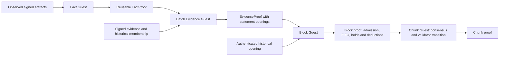

# 20 — Evidence proofs and mandatory sanctions

Status: implemented. Workspace checks for the current nil-vote, authenticated
round-entry, full ChainSpec signing domain and signed-source availability format
passed on 2026-10-04. See the
[acceptance record](21-recursive-checkpoint-proofs.md#acceptance-and-boundaries).
Real compressed EvidenceProof → block → chunk → History composition passed on an NVIDIA
A100 on 2026-10-04; see the [CUDA acceptance record](../gpu-proving.md#cuda-acceptance-record).
History recursion composes completed Chunk statements; it never rechecks evidence offences.

## Composition

An independent SP1 fact Guest first compresses exact cryptographic checks. The
batch evidence Guest recursively verifies these facts and proves objective offences
using historical membership, signed-artifact bindings and explicit verdicts.
Consensus BLS signatures and VRFs use `ConsensusDomain` derived from that
witness's complete authenticated ChainSpec: `tag || chain_id LE8 ||
chain_spec_hash || payload`. Fact requests include these exact bytes; a verdict
or signed source from another specification cannot establish a local offence,
even if both specifications reuse the numeric chain ID and validator keys.
Its statement binds chain ID and complete chain-spec hash, the historical context, stable offender
identity and the existing evidence-independent penalty ID. The runtime block
guest recursively verifies this proof and authenticates the historical opening
against its incoming consensus anchor. The block STF owns replay protection,
the bounded mandatory FIFO, withdrawal holds and deductions. Chunk proofs
consume the block-proven sanctions and only bind their anchor and consensus
effects; they do not replay evidence verification.

Evidence proofs are reusable across blocks: public statements bind a historical
record, not the current chain tip. A counted Merkle history supplies sparse
openings. The root is authenticated from the previous finalized chunk, never
from the current chunk's future certificate. Fact, evidence and block program identities are pinned by
the verifier and bound in the composed public statements.

Network relay uses `EvidenceReport { artifact, history }`.
The reporter supplies the context's 64-level history path alongside the reusable
receipt. Ordinary nodes verify this opening without looking up the old record or
retaining the full tree. The private disk format wraps that report in
`StoredEvidenceReport` with its locally authenticated 32-byte `history_root`, so
an old opening remains verifiable after a snapshot replaces the local history
cache. This stored root is local verification metadata, not a peer-selected anchor.
The existing `EvidenceArtifact` attachment,
`EvidenceSubmission` transaction and Guest history-root semantics are unchanged;
the P2P and pool encoding is replaced directly, with no legacy decoder.

The ordinary-execution host must verify every evidence receipt before WASM
execution. Guest recursion independently checks the same receipts; no supplied
boolean authorizes state changes. Sanction deductions are internal STF operations; the transaction format has no
raw Slash/Leak authorization variants. Inactivity is expressed as an evidence
statement too, without treating certificate non-inclusion as proof of silence.

## Execution and liveness

Only objectively proven, unexpired offences enter the authenticated queue.
Admission fixes the identity, amount and offence ID; pending deductions hold
the offender's withdrawal funds. Every block processes the deterministic FIFO
prefix before ordinary transactions, with a reserved execution budget. Duplicate
submissions cannot duplicate a penalty or block queue progress. Empty-balance
outcomes remain explicit and do not erase the consensus sanction.

The protocol guarantees processing of admitted evidence under chain progress.
It does not claim discovery of hidden signatures or unconditional inclusion of
off-chain reports. Evidence validity windows must fit inside unbonding delays;
admitted pending claims remain enforceable after their admission window ends.
Malformed proofs, verifier panics and resource failures never establish guilt.

## Implementation gates

- [x] Evidence wire statements, sparse historical openings and content identity.
- [x] Independent evidence guest; native parity and SP1 host API.
- [x] Block recursive verification and mandatory runtime queue/withdrawal holds.
- [x] Chunk consumes proven sanctions without evidence verification.
- [x] Node generation, persistent pool, gossip, import and restart paths.
- [x] Adversarial, lifecycle, queue and native/WASM/Guest parity tests.
- [x] Locked workspace build and tests, strict Clippy, CUDA-enabled node Clippy
  and workspace/Guest formatting for the current nil-vote, authenticated round-entry
  and signed-source availability format: 1,010 tests passed, six real-proving
  gates remained ignored; see the
  [acceptance record](21-recursive-checkpoint-proofs.md#acceptance-and-boundaries).
- [x] Real SP1 EvidenceProof → block → chunk → History composition gate: passed on
  CUDA (NVIDIA A100-SXM4-80GB) on 2026-10-04 with independent local verification of
  every receipt; timings in the [CUDA acceptance record](../gpu-proving.md#cuda-acceptance-record).
  CPU acceptance and the history Merge gate remain to be run.

Early fact compression and batch evidence proving are implemented. Individual BFT
votes never wait for a fact proof. A bounded background worker coalesces queued
requests without a timer, observes votes,
attestations, headers and VRFs, compresses up to 64 cryptographic facts per receipt,
and keeps verified results for later offence proofs. The input binds exact key,
message (including chain and domain), signature, or complete signed block-proof
envelope and accepted block program. An explicit false verdict establishes
cryptographic rejection; missing facts and operational failures never do.

A batch EvidenceProof recursively authenticates fact receipts and commits a counted
Merkle root of 1–16 unique offence statements plus the fact-program identity. Its
logical rules still authenticate historical membership, quorum, locks, signed proof
acceptance, chain policy and evidence-independent penalty IDs. Shared facts are
verified once, including a certificate reused for several inactivity claims.
Each attachment carries its statement's counted Merkle opening. The transaction
still commits only the offence statement and historical opening, so selecting a
different valid proof or batch does not change transaction identity. The block
Guest checks every opening, pins the fact program from its trusted anchor, and
recursively verifies each distinct batch only once.

## Statement identity and recursive witnesses

`EvidenceSubmission` commits only the exact public statement and its historical
opening. `Body.evidence_proofs` transports and archives one ordered attachment
per submission, outside the transaction, vote and DA commitments. Missing,
extra, reordered, malformed or mismatched attachments are rejected at execution
and admission boundaries. An attachment carries the evidence program identity;
its cache key is BLAKE3 of the domain-separated evidence/fact programs and
canonical statement.
Alternative valid proofs for that statement have the same transaction identity.

An incoming report path may target the current finalized history root or one of
the preceding eight authenticated roots. The receiver verifies the opening before
expensive receipt verification, then advances it over the bounded finalized append
suffix using the frontier and each appended context commitment. It rechecks and
refreshes the path before storing the verified report, so concurrent finalization
cannot install a path bound to an obsolete root. An older anchor is deferred for
reporter refresh; the offence's source chunk can still be arbitrarily old for a
safety claim. Statement identity excludes the path, so path refresh does not create
another offence receipt. A newer authenticated path updates the stored path and
root while preserving the first verified proof attachment for that statement.

The ordinary host verifies each actual attachment before WASM execution. The
proving host decodes and verifies it once, then supplies the compressed proof and
pinned verification key through SP1's separate proof stream. The block Guest
checks policy, historical bindings, exact statement membership and batch public values, invokes
native SP1 recursive verification and only then executes the STF. No proof bytes
enter the STF input, and no full compressed-proof verifier runs in the block Guest.
Production recursion cannot disable deferred verification.

SP1 execution records recursive claims but does not establish that its proof
stream matches them. The compressed circuit binds the accumulated claim digest
to the verified subproofs, including each program and public-values digest.
Host rejection tests cover the attachment boundaries; only real compressed
composition establishes recursive acceptance. SP1's execution report does not
count the recursive assertion syscall, so its counts cannot establish this gate.

`InvalidProofSigning` still binds the exact block proof envelope signed by every
precommit participant. Fact Guest runs its deterministic exact-byte
rejection verifier for that offence; Evidence Guest authenticates the verdict, and `facts_commitment` still commits the
original signed misconduct evidence. Separating the resulting EvidenceProof
witness changes neither guilt nor the mandatory sanctions and withdrawal holds.
The chunk consumes block-proven effects without verifying evidence again.

Both BFT phases now retain mandatory `VoteAttestation` signer coverage. A prevote
signs its exact optional unlock declaration and has an empty proof-hash list;
a precommit also signs the ordered proof envelopes it accepted. `LockViolation`
can prove an earlier signed precommit and its lock quorum followed by a conflicting
prevote with no valid independent higher-round justification. For a later prevote,
the unlock quorum must be strictly between the old lock round and the later round.
A later precommit may use its current prevote quorum. This closes the circular
case in which illegal conflicting prevotes produce the quorum subsequently used
to excuse their precommits. Certificate validity authenticates the declarations
and carried quorums; proving a violation still requires the earlier signed lock
evidence. A certificate does not establish that no hidden historical offence exists.

Original signed sources now have durable content-addressed availability. Gossip
announces bounded inventories; exact RPC retrieval follows proof-envelope
references and historical lock dependencies. A proof identity remains the exact
BLAKE3 hash of its canonical signed envelope. Accepted receipts resolve through
their existing immutable block-proof storage; rejected alternative bytes remain
available under their distinct identities. Delayed arrival of the earlier lock
quorum or rejected proof re-evaluates only the related signed votes, including
after an authenticated restart replay. See
[signed-source availability](23-evidence-availability.md) for the storage,
transport and resource contract.

The host's exact-receipt verifier decodes bounded envelopes once and passes the
proof directly to the SDK's typed verifier. Circuit, successful exit, program
identity, exact public values and trailing-byte rejection remain mandatory.
The block shell retains an immutable validated-input token and executes that
same input without repeating historical binding checks. Chunk proving and
verification share a lazy in-process key; program keys use the circuit/ELF cache.

## Protocol parameters and retention

There is one current unversioned format for chain specs, headers, proofs, storage
and network paths. Existing
nodes or databases must not silently interpret the new wire format.

Admissibility is selected by `SanctionKind`:

- **Liveness evidence** (`Inactivity`) uses the governable
  `evidence_max_age_blocks` (default 1,024 blocks) and must additionally reference
  one of the eight preceding finalized chunks: for incoming chunk `n`, source IDs
  lie in `[n.saturating_sub(8), n)`. The eighth preceding chunk is admissible; the
  ninth is rejected even with a valid membership proof. This chunk window also
  bounds ordinary embedded votes and chunk-witness historical reads.
- **Safety evidence** (`Slash`: double proposals and votes, lock violations,
  invalid-proof acceptance, signed fork participation, DA fraud, invalid VRF
  claims) has **no age window**. A safety claim may cite any finalized chunk and
  is admitted once per identity, whenever it arrives. The mandatory deduction
  takes whatever slashable balance the offender's address still holds, active
  stake or queued unbonding that has not matured, possibly nothing; consensus
  ejects the identity regardless, so a seated validator without a runtime
  balance is still removed. The fixed 64-level history opening costs the same
  at any age, and the `EvidenceAnchor` carries only the genesis-fixed unbonding
  delay and chunk size. A continuously staked identity remains economically
  accountable for an arbitrarily old safety offence when someone preserves its
  evidence. The unbonding delay bounds the withdrawal exposure after exit, rather
  than the age of admissible safety signatures.

The chain spec requires `evidence_max_age_blocks < unbonding_delay_blocks`,
`unbonding_delay_blocks > chunk_size`, `weak_subjectivity_period_secs <=
unbonding_delay_blocks * slot_duration_secs` (default unbonding is fourteen days),
and nonzero bounded queue throughput; defaults keep 1,024 pending sanctions and 16
admissions/executions per block. The STF asserts the same anchor and policy
invariants on every block. A full FIFO drains within 64 advancing blocks at default
throughput. An admitted obligation does not expire.

Replay protection for liveness offences is bounded by the unbonding delay, not by
chain age: a liveness admission writes a per-offence marker, listed in the expiry
bucket of its admitting height and swept one unbonding delay later, by which time
no liveness claim can bind to it. A safety admission writes a **permanent tombstone
keyed by the offender's BLS public key**. Consensus marks a tombstoned identity
`slashed` at the next boundary and never seats it again, so a second safety claim
against that key, from any chunk and at any later time, is rejected; the number
of tombstones is bounded by the identities ever sanctioned, not by how many
offences they signed. Pruning never expires an admitted FIFO obligation or removes
its current-state withdrawal hold.

Full and validator nodes keep no full history tree. The fixed-depth frontier
authenticates append transitions, and cached paths cover a finite set of historical
records and recent replay boundaries. An independent eight-record window targets
the latest recursive prefix for bootstrap, even when that prefix lags finality.
Older safety reports carry their own opening. Each finalized append atomically
rebases cached and active pooled paths with the new consensus root. Restart checks
active paths against that root and dormant paths against their saved locally
authenticated root. Archives retain the complete immutable tree and can open any
finalized index.

A snapshot jump can omit the intervening append data needed to refresh an arbitrary
old leaf. Installation removes receipts already covered by the authenticated
finalized snapshot state and refreshes reports whose contexts match supplied recent
openings. Other reports keep their proven offence and authenticated old opening as
dormant pool entries. They do not enter block selection or block finalization;
their holder must supply a fresh path before admission. Normal appends skip these
dormant entries. A dormant receipt does not suppress another usable safety report
against the same identity.

Complete historical records (chunk, validator vector, seed and certificate) are
needed to construct evidence from raw reports and to verify incoming raw reports;
they stay for
`history_record_window_chunks = max(8, ceil(unbonding_delay_blocks / chunk_size))`
preceding chunks. This is a local service horizon, not a guarantee that ordinary
nodes retain every signature from an identity that remains bonded indefinitely.
Older sources, records and current openings come from a retaining reporter or
archive. Raw blocks, proofs and signed-source caches keep the eight-chunk window
subject to saved recursive coverage. Pooled liveness receipts expire at the
liveness floor; pooled safety receipts have no age floor and leave only when a
finalized block has sanctioned their identity. Nothing is dropped on the strength
of unfinalized head state, so a reorg cannot lose evidence.

A safety identity is accountable once, and the node applies that rule before any
expensive work. A distinct receipt or raw report against a key the head state has
tombstoned, that finalized history has sanctioned, or that a pooled safety
receipt with a current path under the current Evidence program already covers is
neither verified, stored nor proven; a dormant receipt or one under a superseded
program shields nothing; a network receipt in that position is deferred, not
rejected, because it is
redundant rather than wrong. The exact pooled statement may still receive a newer
authenticated path. Finalizing a safety admission records the identity in `FinalizedSlashes`
next to the offence in `FinalizedOffences`, and the next pruning pass releases
every pooled receipt and raw report against that key. The pool therefore holds at
most one ready safety receipt per identity under the current program; without this
rule a validator that had already been sanctioned could fill the bounded cache with further proven
offences indefinitely and keep every other receipt out.

Signed-source storage observes the current chunk and those eight preceding
authenticated chunks. Full/validator retention follows recursive coverage;
archives can serve older sources without extending evidence admission. The
bounded forensic cache reserves durable local publication capacity and protects
actual locks. Live admission counts only the current and preceding-eight chunk
window; older rows waiting for recursive coverage do not gate BFT publication.
Total disk use can grow while recursive proving falls behind, and pruning keeps
the saved-coverage guard. Superseded uninvolved messages from indefinitely unfinalized rounds
may expire under the explicit local rolling policy. Peer cache deferral does not
prevent live BFT admission. Availability therefore improves discovery of
published, retained offences without claiming recovery of hidden signatures or
unlimited round history on finite storage.

Historical context commits the chunk, membership and seed, independently of a
certificate's signer subset. Different valid certificates must produce the same
incoming historical root. Inactivity retains the protocol's narrow meaning:
non-inclusion in the submitted valid certificate, not proof that a validator
never voted. The exact submitted certificate is checked by Evidence Guest using
recursively authenticated cryptographic facts and committed by the claim; its resulting transaction is ordered by consensus.
Every claim binds the complete chain-spec hash and block program identity.

Receipt bytes are capped at 2 MiB. The off-chain cache holds at most 256 reports
and 32 MiB including active and dormant entries, history paths and the private
32-byte root metadata per report. It preserves the first verified attachment while
allowing its path and root to refresh, and prunes when its
admission is finalized, when a finalized block has sanctioned its safety identity,
or (liveness only) when its admission window is behind finalized history.
Receipts executed on an unfinalized branch remain available across reorgs. The block builder reserves
mandatory execution gas and bounds attachment plus ordinary transaction bytes.
Background jobs run outside the engine lock; startup/network initialization,
evidence arrival, finalization and production trigger work. Failed raw reports
rotate through bounded batches, preserving capacity for inactivity proofs.

Withdrawals are held by runtime withdrawal account, matching existing shared
collateral semantics. Several BLS identities using one account share its funds;
no design can deduct more collateral than the account contains. Such zero-balance
outcomes are explicit, while the cryptographic identity sanction still applies.

## Acceptance artifacts

`runtime-host/tests/evidence_pipeline.rs` includes native/WASM/Guest rejection,
evidence Guest/native parity, and the ignored real CPU gate
`evidence_block_chunk_real_compressed_recursion`. The real gate starts at an
explicit trusted finalized history fixture, proves the signed offence, recursively verifies that statement and proves
its actual deduction from 100 stake, then proves and verifies the containing
consensus chunk and validator sanction. It must run with real compressed proofs;
mock SP1 receipts are never accepted by the production evidence verifier.

Run the workspace checks in `AGENTS.md` and the separate real gate with
`scripts/check-evidence-proof.sh`. Native execution and mock recursion do not
establish real compressed composition acceptance. Acceptance of a previous ELF
cannot be carried over to changed programs.

The gate atomically saves each verified evidence, block and chunk proof under
`target/proof-acceptance/evidence-pipeline`, configurable with
`NEUTRINO_EVIDENCE_GATE_DIR`. Checkpoint identities bind the circuit version,
stage ELF, exact inputs and expected statement. Block witness inputs include the exact
evidence attachment; chunk inputs include the exact block proof and attestations.
Restart reuses a matching stage only after cryptographic verification against its
current expected statement. Invalid or corrupt checkpoints fail the gate;
unfinished writes cannot publish a successful stage. Changed programs or inputs
use separate artifacts, so a completed predecessor never authorizes a changed ELF.

Long CPU gates can run from frozen test executables and subscribe to the preceding
process's exit with kqueue. A local macOS notification reports completion; this
mechanism does not send an automatic chat message or poll the prover. Keep the
executable hash and final verdict with that run's artifacts.

## Fact cache and scheduling

Fact receipts are local acceleration artifacts, not new consensus gossip messages.
The early queue has eight slots of at most 2 MiB and one blocking worker. The
worker drains at most eight additional queued groups per dispatch, deduplicates
facts, and proves misses in groups of at most 64; saturation
skips optional precomputation. Evidence proving fills any missing facts on demand.
Neither queueing nor receipt generation holds the engine mutex. Fact receipts are
retained by circuit and fact-program identity under the SP1 cache directory, with
256 receipts and 32 MiB maximum retention. Fresh receipts are verified before cache
insertion; persisted receipts are bounded, decoded and verified again on restart.
Corrupt files are discarded. Cache loss only costs recomputation.

The real composition gate now covers FactProof → batched EvidenceProof → block →
chunk. Native checks and execution-only Guest tests do not establish this gate;
local real proving remains cancelled at the user's request. Batch equations and
negative-fact omission/cancellation attacks have dedicated adversarial tests.
